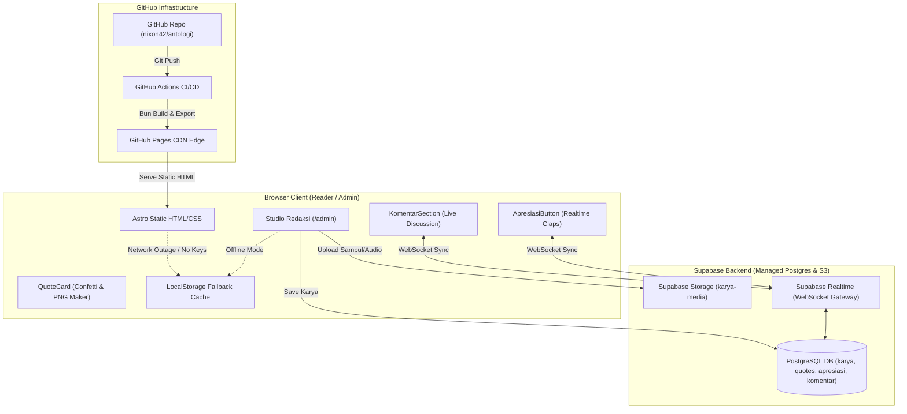
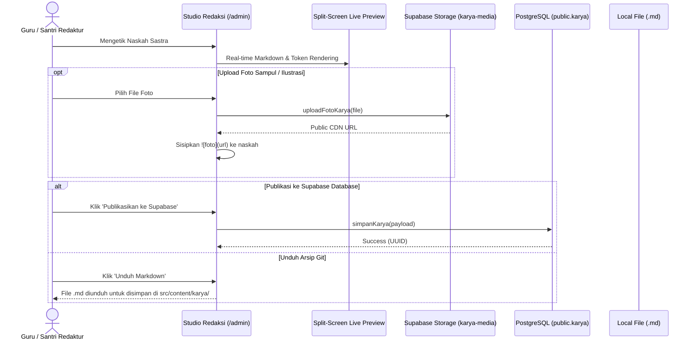

# Architecture & Data Flow Blueprint

> **System Architecture Document for Ruang Sastra (`antologi`)**  
> Visual reference and subsystem documentation for engineers and autonomous agents.

---

## 1. High-Level Architecture Overview

Ruang Sastra employs a **Static-First Hybrid Jamstack** model:



---

## 2. Subsystems Description

### 2.1 The Static Layer (SSG)
- **Role:** Guarantees sub-second Time-to-First-Byte (TTFB), 100/100 Lighthouse performance, and zero hosting costs.
- **Content Storage:** Initial archived works live in `src/content/karya/*.md`.
- **Pre-rendering:** Astro compiles all routes (`/`, `/karya`, `/karya/[...slug]`, `/panggung`, `/quotes`, `/tentang`, `/kirim`, `/admin`) into pure HTML + CSS + optimized JS bundles at build time.
- **Search Endpoint:** `src/pages/search-index.json.ts` pre-indexes all titles, excerpts, authors, and categories for instant client-side fuzzy searching with Fuse.js (`Ctrl+K`).

### 2.2 The Dynamic Companion Layer (Supabase)
- **Role:** Handles live social interactions, administrative publishing, and media uploads without requiring a custom server or Docker container.
- **Unified Wrapper:** `src/lib/supabase.ts` encapsulates all Supabase SDK calls and detects environment readiness.
- **Data Entities:**
  1. `public.karya`: Core literary submissions and published articles.
  2. `public.quotes`: Literary aphorisms for cards.
  3. `public.apresiasi`: Upvote/clap counter per work with high concurrency upserts.
  4. `public.komentar`: Moderated and public reader commentary thread.
  5. `storage.buckets/karya-media`: Public image and audio assets.

### 2.3 The Zero-Fragility Fallback Subsystem
- **Design Philosophy:** A literary portal should **never show a blank screen or fatal crash** because a 3rd party API is unconfigured or blocked by adblockers.
- **Mechanics:**
  ```mermaid
  sequenceDiagram
      autonumber
      participant Component as UI Component
      participant Client as Supabase Client
      participant Local as LocalStorage
      
      Component->>Client: Request Data (e.g. getApresiasiCount)
      alt Supabase Configured & Online
          Client-->>Component: Returns PostgreSQL DB count
      else Keys Missing OR Network Offline
          Client-->>Local: Fallback query rs_apresiasi_*
          Local-->>Component: Returns cached local count
      end
  ```

---

## 3. Data Flow: Publishing via Studio Redaksi (`/admin`)



---

## 4. Security & Access Boundaries

| Surface | Protocol / Port | Auth Method | RLS / Firewall Policy |
| :--- | :--- | :--- | :--- |
| **Public Site** | HTTPS (443) | Anonymous | Cloudflare + GitHub Pages CDN |
| **Supabase REST** | HTTPS (443) | `apikey` (Publishable Key) | RLS: SELECT allowed on `status='published'`, INSERT allowed for submissions |
| **Supabase Realtime** | WSS (443) | `apikey` | Filtered by `karya_id=eq.{id}` |
| **Storage Uploads** | HTTPS (443) | `apikey` | Bucket `karya-media` public read, insert enabled |
| **CI/CD Pipeline** | GitHub Actions | Repository Secrets | Read-only repo access, write to GitHub Pages environment |
